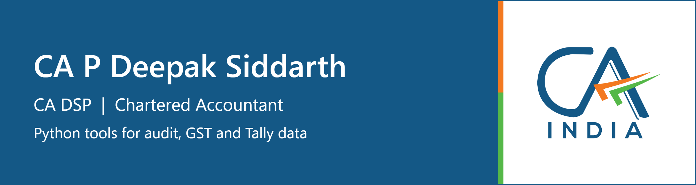
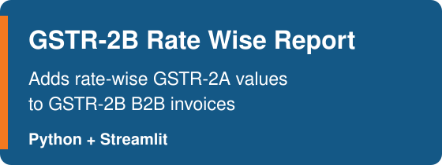
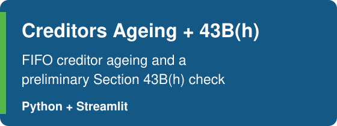

I am a Chartered Accountant who builds small Python tools for audit, GST and tax working papers. I share what I learn on my blog.

## Projects

## Topics covered

| 🧾 GST | 🔍 Audit | 📒 Tally data | ⚖️ Income tax |
|:---:|:---:|:---:|:---:|
| GSTR-2A and 2B | Ledger scrutiny | Exports and analysis | TDS and 43B(h) |

## Tools

---

Please do not post client or taxpayer data in issues or pull requests.

