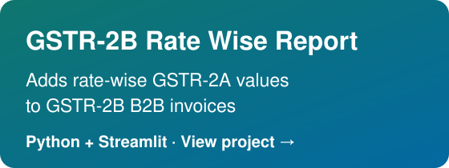
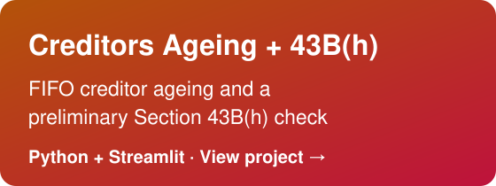

### 👋 Hello, welcome to my profile

I am a Chartered Accountant who builds small Python tools to make audit, GST and tax working papers quicker to prepare and easier to check.

## 🚀 Projects

## 📊 Areas I work on

| 🧾 GST | 🔍 Audit | 📒 Tally data | ⚖️ Income tax |
|:---:|:---:|:---:|:---:|
| GSTR-2A and 2B | Ledger scrutiny | Exports and analysis | TDS and 43B(h) |

## 🛠️ Tools

---

🔒 Please do not post client or taxpayer data in issues or pull requests.

